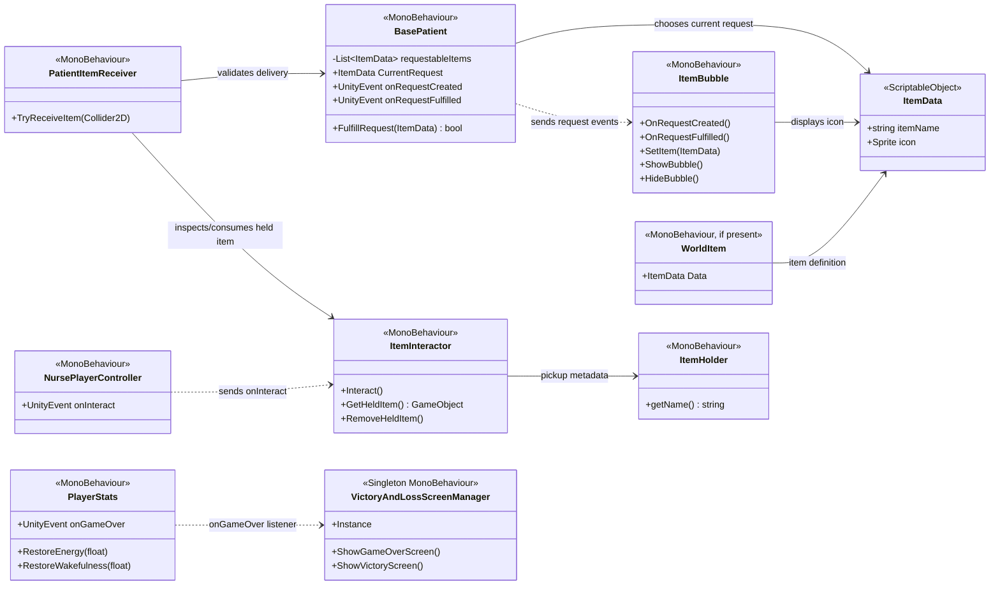

# Last Shift

A 2D Unity game in which the player controls a nurse, collects items, and delivers the correct supplies to patients while managing energy and wakefulness. Patients periodically request one item from a configurable set of `ItemData` assets. Delivering the requested item fulfills the request; depleted player stats can trigger the game-over scene.

## Requirements and running the game

- **Unity:** Open the project with the Unity Editor version specified by `ProjectSettings/ProjectVersion.txt` (preferably through Unity Hub).
- **Input:** The project uses Unity's **Input System** package. Make sure the package is installed and the project's input actions are assigned in the Inspector.
- **Scenes:** Open the main gameplay scene from `Assets/` and press **Play**. The gameplay scene name may differ between project versions.
- **Movement:** Use the controls bound to the `Move` input action. The `NursePlayerController` and `PlayerStats` components must reference the intended movement action.
- **Interaction:** Use the control bound to the `Interact` input action to pick up or drop an item. A patient automatically accepts the correct carried item when the nurse enters its delivery trigger.
- **Debugging patient requests:** While playing in the Editor, press **R** to trigger a patient request (configurable via `BasePatient.debugRequestKey`). If several patients use the same key, they may all react.

### Building and running outside the Editor

1. Open **File → Build Profiles**.
2. Add the gameplay scene and any scenes loaded by name, including `GameOverScreen` and the victory scene if used, to the **active profile's Scene List**. Ensure they are enabled.
3. Select the target platform (for example **Web** for WebGL or **Android**) and build.
4. For a Web build, serve the generated files through a web server or upload the build in the format required by the hosting service; do not rely on opening `index.html` directly from the filesystem.

If scene loading reports that `GameOverScreen` is missing, verify both its exact asset name and its inclusion in the active Scene List.

## Gameplay overview

1. `BasePatient` waits a random interval and selects **one** current request from its `requestableItems` list.
2. `BasePatient` raises `onRequestCreated`; the `ItemBubble` listener reads the request's `ItemData.icon` and displays it.
3. `ItemInteractor` picks up a nearby item and parents it to the nurse's `HoldItemPoint`, disabling the carried item's collider.
4. `PatientItemReceiver` detects the nurse through the patient's trigger collider, reads the held item's `ItemData`, and asks `BasePatient.FulfillRequest(...)` to validate it.
5. On a successful match, the held item is consumed, `onRequestFulfilled` is raised, the bubble is hidden, and the patient starts a new request timer.
6. `PlayerStats` drains energy and wakefulness during movement. When a critical stat reaches zero, it raises `onGameOver`, which can load the game-over scene through the manager.

## Class and event diagram

**Event senders and listeners**

| Sender | Event | Listener | Effect |
| --- | --- | --- | --- |
| `NursePlayerController` | `onInteract` | `ItemInteractor.Interact()` | Picks up or drops an item. |
| `BasePatient` | `onRequestCreated` | `ItemBubble.OnRequestCreated()` | Reads `CurrentRequest`, sets the icon, and shows the bubble. |
| `BasePatient` | `onRequestFulfilled` | `ItemBubble.OnRequestFulfilled()` | Hides the bubble and clears the icon. |
| `PlayerStats` | `onGameOver` | `VictoryAndLossScreenManager.ShowGameOverScreen()` | Loads the game-over scene. |

**Important:** These connections use UnityEvents. Configure persistent listeners in the Inspector where appropriate. `ItemInteractor` registers its interaction listener in code; do **not** register that same listener again in the Inspector, or a single press may cause both pickup and drop. `ItemBubble` uses the current request at event time rather than assigning a fixed item to the event.

## Design decisions and alternatives

### 1. ScriptableObject item definitions instead of one script per item

**Choice:** Use `ItemData : ScriptableObject` to store each item's name and icon. Patient requests and world items reference the same asset.

**Alternative:** Create a separate subclass or prefab script for each item type, or compare item names as strings.

**Reason:** Shared asset references reduce duplication, make new item types configurable in the Editor, and allow reliable reference comparison (`deliveredItem == CurrentRequest`). Keep per-instance state such as “currently held” on GameObjects, not on the shared `ItemData` asset.

### 2. UnityEvents for communication instead of hard-coded UI and scene dependencies

**Choice:** `BasePatient` raises request events, and `PlayerStats` raises a game-over event. Listeners handle the bubble and scene transition.

**Alternative:** Have `BasePatient` directly call `ItemBubble` methods and `PlayerStats` directly call the game manager.

**Reason:** Events separate gameplay state from presentation and scene management. Other listeners (sound effects, scoring, animations) can be added without rewriting request logic. The tradeoff is that Inspector event connections must be checked when debugging.

### 3. A persistent game manager instead of a separate manager in every scene

**Choice:** `VictoryAndLossScreenManager` uses a singleton `Instance` and `DontDestroyOnLoad` to persist across scene changes.

**Alternative:** Put a new manager in each scene, or use scene-specific UI controllers and pass state explicitly between scenes.

**Reason:** A single manager centralizes transitions and level progression, preventing scene-to-scene state from being reset accidentally. The tradeoff is global state: the singleton must reject duplicate instances and reset transient flags when restarting a level.

## Adding content: which files or assets change?

### Add a new item

1. **Create an asset:** In Unity, right-click the Project window → **Create → Hospital → Item**. Fill in `itemName` and `icon`. No change to `ItemData.cs` is required for a basic new item.
2. **Make it spawnable:** Assign the new `ItemData` asset to the appropriate item spawner or world-item prefab configuration. Depending on the project version, item identity may be exposed by `WorldItem.Data` or `ItemHolder`; ensure the pickup and delivery systems read the same `ItemData` asset.
3. **Allow patients to request it:** Add the asset to the patient's `BasePatient.requestableItems` list in the Inspector.
4. **Check the UI:** The existing `ItemBubble.SetItem(ItemData)` should display the new `icon` automatically; no new bubble method is needed.
5. **Test delivery:** Confirm that carrying the corresponding world item fulfills the request and removes the item from the nurse.

**Typical changes:** New `ItemData` `.asset`, item spawner/prefab Inspector values, and patient prefab/scene Inspector values. Usually **no C# changes**.

### Add a new enemy

> **Not yet documented as an implemented system:** The known hospital-game scripts do not establish an enemy base class, enemy spawning, or enemy damage. The following is an extension plan, not a claim that these files already exist.

1. Create an **enemy prefab** with sprite, collider, and any required Rigidbody2D.
2. Add an **enemy behavior script** (for example `EnemyController.cs`) for movement, targeting, and interaction with the nurse.
3. Add a **damage or penalty interface/component** (for example `PlayerDamageReceiver.cs`) that applies a defined consequence to `PlayerStats`. Avoid modifying UI bar widths directly from enemy code; expose a public stats method instead.
4. If enemies spawn dynamically, add or extend an **enemy spawner** and its scene/prefab configuration.
5. Add enemy-specific audio, animations, and balancing data as needed; test collision layers and trigger behavior.

**Typical changes:** New enemy prefab and scripts; optionally `PlayerStats.cs` to expose a damage/penalty method, and a spawner or level configuration. `BasePatient`, `ItemData`, and `ItemBubble` should not need changes unless the enemy affects patient requests.

## Singleton and static-variable rationale

| Element | Why it exists | Scope / caution |
| --- | --- | --- |
| `VictoryAndLossScreenManager.Instance` (static property) | Gives other systems a single access point to the persistent scene-transition manager. | Global reference, not separate manager state for each scene. Destroy duplicate managers and clear `Instance` when the surviving manager is destroyed. |
| `DontDestroyOnLoad(gameObject)` | Keeps the manager alive when moving from gameplay to victory/game-over scenes. | Use only for objects whose state or behavior must persist across scenes. |
| `PlayerStats.BAR_HEIGHT` (`const`) | Gives every stat bar the same fixed UI height. | Compile-time constant; not mutable global game state. |

The current item request, held item, timers, and player stat values should remain **instance state**, not static fields: different patients and players must be able to maintain independent state. `ItemData` is shared through asset references, but is **not** itself a singleton.

## Troubleshooting

- **No patient requests:** Ensure `BasePatient` is enabled, the patient GameObject is active, and `requestableItems` contains valid assets. Press **R** in the focused Game window to test.
- **Bubble remains empty:** Assign the `ItemIcon` SpriteRenderer in `ItemBubble`, assign the patient reference, and connect `onRequestCreated` to `ItemBubble.OnRequestCreated()`.
- **Delivery does nothing:** Confirm the patient's collider has **Is Trigger** enabled, the nurse has a Collider2D and Rigidbody2D, and the held item exposes the correct `ItemData` asset.
- **Item drops immediately after pickup:** Check that `NursePlayerController` invokes `onInteract` only once per press and that the listener is not registered both in code and in the Inspector.
- **Stats do not drain:** Assign the intended `Move` Input Action to `PlayerStats`.
- **Game-over scene fails to load:** Add the scene to the active Build Profile's Scene List and verify the exact scene name.

## Known implementation notes

- The patient currently has **one active request at a time**, even if its `requestableItems` list contains many possible items.
- `WorldItem` and `ItemHolder` have both been discussed as item-identity components. Confirm which is present on your actual item prefab and standardize the delivery code on that component.
- The current `PlayerStats` implementation stores stat values indirectly as UI bar widths. For future expansion, store numeric stats separately and make the bars a visual representation of those values.
- Check the actual repository for its final game title, scene paths, input mappings, and platform-specific UI behavior before publishing this README.

## itch.io: https://gal-eitan.itch.io/last-shift-core-process
